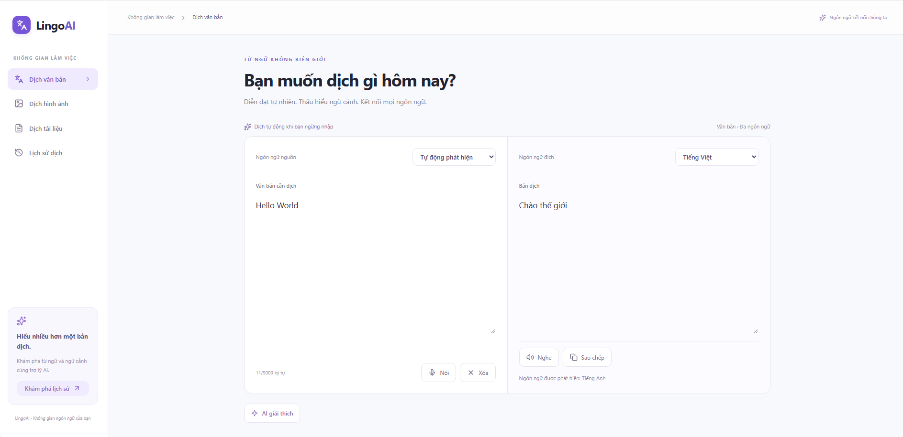
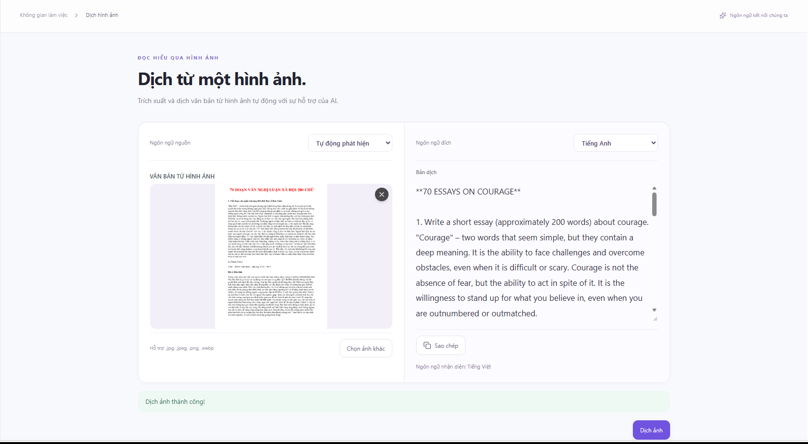
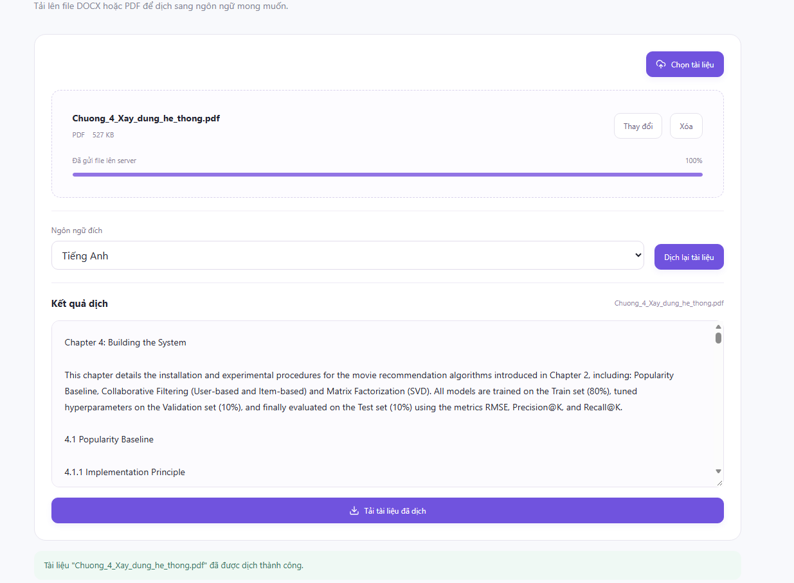
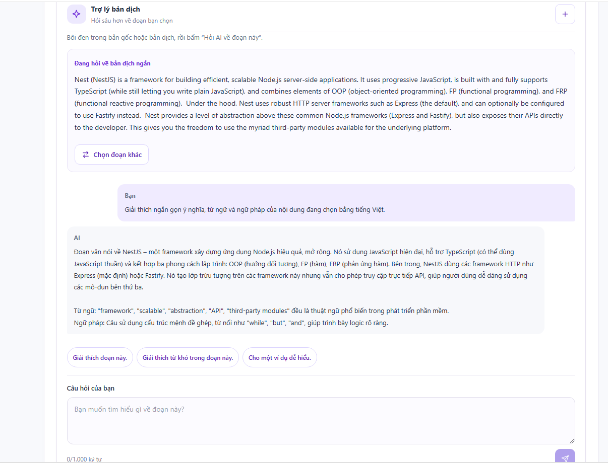
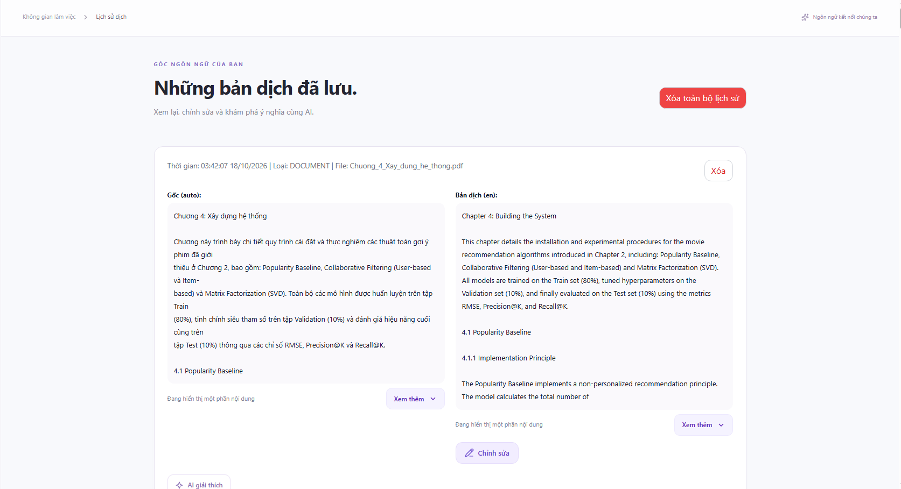
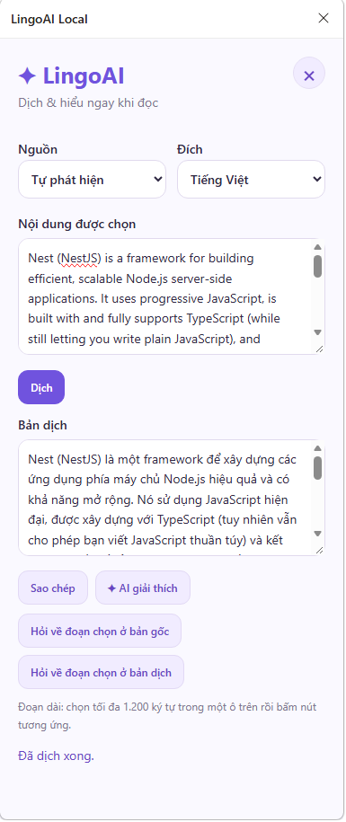

# LingoAI

Ứng dụng web dịch thuật đa ngôn ngữ tích hợp AI **chạy hoàn toàn cục bộ**: văn bản, giọng nói, hình ảnh (OCR) và tài liệu DOCX/PDF. Các mô hình ngôn ngữ chạy qua [Ollama](https://ollama.com) trên máy của bạn, không cần API key và không gửi dữ liệu lên dịch vụ đám mây.

> Đồ án chuyên ngành – Đại học Công nghiệp Hà Nội. Nhóm 14, GVHD: Nguyễn Ngọc Khải.

## Mục lục

- [Tính năng](#tính-năng)
- [Ảnh giao diện](#ảnh-giao-diện)
- [Công nghệ](#công-nghệ)
- [Kiến trúc](#kiến-trúc)
- [Yêu cầu môi trường](#yêu-cầu-môi-trường)
- [Cài đặt và chạy](#cài-đặt-và-chạy)
- [Cấu hình biến môi trường](#cấu-hình-biến-môi-trường)
- [Tiện ích Chrome](#tiện-ích-chrome)
- [Cấu trúc thư mục](#cấu-trúc-thư-mục)
- [API](#api)
- [Giới hạn đã biết](#giới-hạn-đã-biết)
- [Xử lý sự cố](#xử-lý-sự-cố)
- [Giấy phép](#giấy-phép)

## Tính năng

| Chức năng | Mô tả |
| --- | --- |
| Dịch văn bản | Tự động dịch sau 1,5 giây ngừng gõ; tối đa 5.000 ký tự; hỗ trợ tự phát hiện ngôn ngữ nguồn |
| Dịch giọng nói | Nhập bằng micro và đọc bản dịch (Web Speech API của trình duyệt) |
| Dịch hình ảnh | Chọn, kéo thả hoặc dán ảnh (Ctrl + V); OCR bằng Tesseract.js (tiếng Việt, tiếng Anh) rồi dịch |
| Dịch tài liệu | Tải lên DOCX/PDF, dịch và tải về bản dịch giữ bố cục |
| AI giải thích | Hỏi đáp về bản dịch, phản hồi theo luồng (streaming) |
| Lịch sử dịch | Xem, chỉnh sửa, khôi phục bản gốc, xóa; tự dọn tài liệu và ảnh quá 7 ngày |
| Tiện ích Chrome | Bôi đen văn bản trên trang web, chọn "Dịch với LingoAI" để dịch và hỏi AI ở Side Panel |

Ngôn ngữ hỗ trợ (8): Tiếng Việt, Tiếng Anh, Tiếng Nhật, Tiếng Hàn, Tiếng Trung giản thể, Tiếng Pháp, Tiếng Đức, Tiếng Tây Ban Nha.

## Ảnh giao diện

> Đặt ảnh chụp màn hình vào thư mục `docs/screenshots/` với đúng tên file bên dưới (hoặc đổi đường dẫn cho khớp).

### Dịch văn bản



*Trang "Dịch văn bản": tự động dịch sau khi ngừng gõ, hiển thị ngôn ngữ nguồn được phát hiện.*

### Dịch giọng nói


*Nút "Nói" ở trạng thái đang nghe và văn bản được điền vào ô nhập.*

### Dịch hình ảnh



*Vùng kéo thả / dán ảnh, ảnh xem trước bên trái và bản dịch bên phải.*

### Dịch tài liệu



*Tải lên DOCX/PDF, thanh tiến độ và nút tải bản dịch.*

### AI giải thích



*Bảng "AI giải thích" trả lời theo luồng về đoạn được bôi đen.*

### Lịch sử dịch



*Danh sách lịch sử, chỉnh sửa bản dịch và khôi phục bản gốc của AI.*

### Tiện ích Chrome



*Side Panel của tiện ích sau khi bôi đen văn bản và chọn "Dịch với LingoAI".*

## Công nghệ

**Frontend** (`client/`): React 19, Vite, React Router 7, Tailwind CSS 4, Radix Slot, lucide-react.

**Backend** (thư mục gốc, mã nguồn trong `src/`): Node.js (ES Modules), Express 5, Mongoose/MongoDB, Multer (lưu file trong bộ nhớ), Tesseract.js, mammoth, cheerio, pdfjs-dist, JSZip, @xmldom/xmldom, Puppeteer, node-cron.

**Mô hình AI** (chạy qua Ollama, gọi `POST /api/chat`):

| Vai trò | Biến môi trường | Mô hình |
| --- | --- | --- |
| Dịch văn bản và tài liệu | `OLLAMA_TRANSLATION_MODEL` | `translategemma:4b` |
| Nhận diện ngôn ngữ nguồn | `OLLAMA_DETECTION_MODEL` | `qwen3:4b` |
| AI giải thích (chat) | `OLLAMA_CHAT_MODEL` | `qwen3:4b-instruct` |

## Kiến trúc

```
Trình duyệt (React, :5173)  ──/api (Vite proxy)──▶  Express (:5001)  ──▶  Ollama (:11434)
Tiện ích Chrome (Side Panel) ───────────────────────▶       │
                                                            └──▶  MongoDB (TranslationHistory)
```

- Frontend gọi `/api/...`; khi phát triển, Vite chuyển tiếp sang backend (mặc định `http://127.0.0.1:5001`, đổi bằng `BACKEND_URL`).
- Backend kiểm tra dữ liệu, gọi Ollama, lưu lịch sử vào MongoDB và tự dọn dữ liệu cũ lúc 00:00 mỗi ngày.
- Chỉ có một collection `TranslationHistory`; ứng dụng chưa có tài khoản người dùng.

## Yêu cầu môi trường

- [Node.js](https://nodejs.org/) bản LTS mới và npm
- [MongoDB](https://www.mongodb.com/docs/manual/installation/) đang chạy
- [Ollama](https://ollama.com/download) đã cài đặt; máy cần đủ bộ nhớ cho các mô hình 4B tham số
- Trình duyệt Chrome hoặc Edge (cho giọng nói và tiện ích; tiện ích cần Chrome 124 trở lên)

## Cài đặt và chạy

1. **Tải mô hình:**

   ```bash
   ollama pull translategemma:4b
   ollama pull qwen3:4b
   ollama pull qwen3:4b-instruct
   ```

2. **Cài thư viện** (backend ở thư mục gốc, frontend trong `client/`):

   ```bash
   npm install
   npm install --prefix client
   ```

3. **Tạo file `.env`** ở thư mục gốc từ `.env.example` và điền giá trị (xem [bên dưới](#cấu-hình-biến-môi-trường)). Tối thiểu:

   ```env
   PORT=5001
   MONGODB_URI=mongodb://127.0.0.1:27017/ai-translate
   OLLAMA_BASE_URL=http://127.0.0.1:11434
   OLLAMA_CHAT_MODEL=qwen3:4b-instruct
   OLLAMA_TRANSLATION_MODEL=translategemma:4b
   OLLAMA_DETECTION_MODEL=qwen3:4b
   ```

4. **Chạy cả backend và frontend:**

   ```bash
   npm run dev
   ```

5. **Kiểm tra:** mở <http://localhost:5173> để dùng ứng dụng, và <http://localhost:5001/api/health> để kiểm tra backend.

### Các lệnh npm (chạy ở thư mục gốc)

| Lệnh | Chức năng |
| --- | --- |
| `npm run dev` | Chạy đồng thời backend và frontend |
| `npm run dev:server` | Chỉ chạy backend (`node --watch --env-file=.env src/server.js`) |
| `npm run dev:client` | Chỉ chạy frontend (Vite, cổng 5173) |
| `npm start` | Chạy backend, không theo dõi thay đổi |
| `npm run build` | Build frontend vào `client/dist/` |

## Cấu hình biến môi trường

| Biến | Ý nghĩa | Mặc định |
| --- | --- | --- |
| `PORT` | Cổng backend | `5001` |
| `MONGODB_URI` | Chuỗi kết nối MongoDB | (không có) |
| `OLLAMA_BASE_URL` | Địa chỉ Ollama | `http://127.0.0.1:11434` |
| `OLLAMA_TRANSLATION_MODEL` | Mô hình dịch | `translategemma:4b` |
| `OLLAMA_DETECTION_MODEL` | Mô hình nhận diện ngôn ngữ | `qwen3:4b` |
| `OLLAMA_CHAT_MODEL` | Mô hình AI giải thích | `qwen3:4b-instruct` |
| `OLLAMA_DOCUMENT_MODEL` | Mô hình dịch tài liệu (không bắt buộc; chưa có trong `.env.example`) | `OLLAMA_MODEL`, nếu không có thì `qwen3:4b` |
| `OLLAMA_TRANSLATION_TIMEOUT_MS` | Thời gian chờ tối đa mỗi lần gọi Ollama | `120000` |
| `OLLAMA_DEBUG` | Bật ghi log chi tiết khi gọi Ollama | tắt |
| `OLLAMA_CHAT_DISABLE_THINKING` | Tắt chế độ suy luận của mô hình chat | tắt |
| `PDF_BROWSER_PATH` | Đường dẫn Chromium/Chrome cho Puppeteer khi xuất PDF | (dùng Chromium của Puppeteer) |
| `BACKEND_URL` | Địa chỉ backend cho proxy của Vite (đọc từ `.env` trong `client/`) | `http://127.0.0.1:5001` |

## Tiện ích Chrome

1. Mở `chrome://extensions` và bật **Chế độ nhà phát triển**.
2. Chọn **Tải tiện ích đã giải nén** và trỏ tới thư mục `extension/`.
3. Chạy backend, bôi đen văn bản trên một trang web, bấm chuột phải và chọn **Dịch với LingoAI**.

Tiện ích (Manifest V3) chỉ kết nối tới `localhost` / `127.0.0.1`, nên backend phải đang chạy trên máy của bạn.

## Cấu trúc thư mục

```
.
├── package.json            # script và thư viện backend
├── .env.example            # mẫu biến môi trường
├── eng.traineddata         # dữ liệu ngôn ngữ cho Tesseract OCR
├── vie.traineddata
├── src/                    # backend
│   ├── server.js           # điểm khởi động
│   ├── app.js              # cấu hình Express, route
│   ├── config/             # kết nối DB, cron dọn dữ liệu
│   ├── models/             # TranslationHistory
│   ├── routes/             # translation, ocr, document, explanation, history
│   ├── controllers/
│   ├── middlewares/
│   ├── services/           # llm, document, pdf, docx, explanation
│   └── uploads/            # file gốc của ảnh/tài liệu đã dịch
├── client/                 # frontend React + Vite
│   └── src/                # pages, components, hooks, services, constants
└── extension/              # tiện ích Chrome (Manifest V3)
```

## API

Tất cả endpoint nằm dưới `/api`.

| Phương thức | Đường dẫn | Chức năng |
| --- | --- | --- |
| GET | `/api/health` | Kiểm tra backend |
| POST | `/api/translations` | Dịch văn bản (JSON: `text`, `sourceLanguage`, `targetLanguage`) |
| POST | `/api/ocr` | OCR ảnh (multipart, trường `image`) |
| POST | `/api/translations/document` | Dịch tài liệu DOCX/PDF (multipart, trường `file`) |
| GET | `/api/translations/document/:id/download` | Tải bản dịch (DOCX hoặc PDF) |
| POST | `/api/explanations/chat` | Hỏi AI giải thích, phản hồi NDJSON theo luồng |
| GET | `/api/history` | Danh sách lịch sử, mới nhất trước |
| PATCH | `/api/history/:id/content` | Lưu bản dịch đã chỉnh sửa (kèm `revision`) |
| POST | `/api/history/:id/restore` | Khôi phục bản dịch gốc của AI |
| DELETE | `/api/history/:id`, `/api/history` | Xóa một bản ghi / toàn bộ lịch sử |

Lỗi trả về dạng JSON với thông báo tiếng Việt; một số mã thường gặp: 400 (dữ liệu không hợp lệ), 409 (xung đột phiên bản khi sửa lịch sử), 413 (vượt giới hạn), 422 (không xử lý được tệp), 429 (AI đang bận), 503 (không kết nối được Ollama hoặc chưa tải mô hình), 504 (quá thời gian chờ).

## Giới hạn đã biết

| Mục | Giới hạn |
| --- | --- |
| Văn bản | Tối đa 5.000 ký tự mỗi lần dịch |
| Ảnh | `.jpg`, `.jpeg`, `.png`, `.webp`, tối đa 5 MB; OCR chỉ nạp tiếng Việt và tiếng Anh |
| Tài liệu | `.docx` hoặc `.pdf`, tối đa 20 MB, 20.000 ký tự, 200 đoạn; PDF dạng ảnh quét chưa hỗ trợ |
| AI giải thích | Một lượt hỏi tại một thời điểm; trả lỗi 429 khi đang bận |
| Xác thực | Chưa có tài khoản; lịch sử dùng chung cho toàn hệ thống |
| Kiểm thử | Chưa có bộ kiểm thử tự động đi kèm (`npm test` chưa được cấu hình) |

Bản PDF xuất ra được dựng lại từ HTML nên có thể khác bố cục và phông chữ của file gốc.

## Xử lý sự cố

| Triệu chứng | Cách xử lý |
| --- | --- |
| Báo lỗi 503, "không tìm thấy mô hình" | Chạy `ollama list`, bảo đảm đã `ollama pull` đủ ba mô hình và tên khớp với `.env` |
| Backend báo không kết nối được MongoDB | Kiểm tra MongoDB đang chạy và `MONGODB_URI` đúng; các chức năng lưu lịch sử sẽ báo lỗi nếu thiếu DB |
| Lỗi 504 hoặc dịch rất chậm | Lần gọi đầu phải nạp mô hình vào bộ nhớ; tăng `OLLAMA_TRANSLATION_TIMEOUT_MS` nếu máy yếu |
| Frontend không gọi được `/api` | Kiểm tra backend chạy ở cổng 5001 hoặc đặt `BACKEND_URL` đúng |
| Xuất PDF lỗi | Đặt `PDF_BROWSER_PATH` trỏ tới Chrome/Chromium đã cài |
| Nút "Nói" không hoạt động | Dùng Chrome hoặc Edge và cấp quyền micro cho trang |

## Giấy phép

ISC (theo `package.json`).
